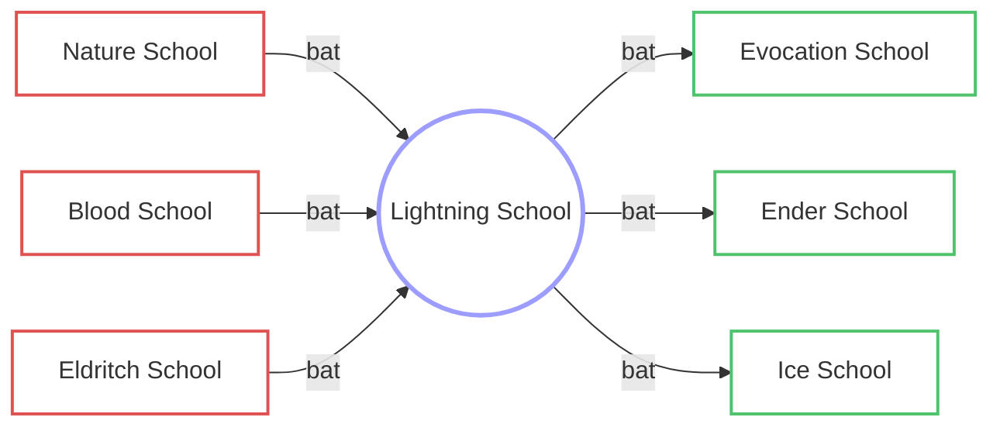

|                                  | Base | Skiltree                                                             | Autre | Total  | Total Points |
| -------------------------------- | ---- | -------------------------------------------------------------------- | ----- | ------ | ------------ |
| ==🟢Lightning Spell Power==      | 100% | 5% skilltree CLASS ==(1 x 5%)== 20% skilltree ==(20 x 1%)== |       | 125%   | 20           |
| ==🟢Lightning Magic Resistance== | 100% | 5% skilltree CLASS ==(1 x 5%)== 20% skilltree ==(20 x 1%)== |       | 125%   | 20           |
| ==🟢Spell resistance==           | 100% | 12.5% skilltree ==(10 x 1.25%)==                                  |       | 112.5% | 10           |
| ==🔴Nature Magic Resistance==    | 100% | -25% skilltree ==(50 x -0.5%)==                                   |       | 75%    | 50           |
| ==🔴Eldritch Magic Resistance==  | 100% | -25% skilltree ==(50 x -0.5%)==                                   |       | 75%    | 50           |
| ==🔴Blood Magic Resistance==     | 100% | -25% skilltree ==(50 x -0.5%)==                                   |       | 75%    | 50           |

---

## ⚡ Affinités

> [!abstract] Résumé
> Voir la [[Table des affinités]] pour la vue d'ensemble.

> [!success] 🟢 Fort contre
>
> - [[Evocation School|🔮 Evocation]]
> - [[Ender School|🌌 Ender]]
> - [[Ice School|❄️ Ice]]

> [!failure] 🔴 Faible contre
>
> - [[Nature School|🌿 Nature]]
> - [[Blood School|🩸 Blood]]
> - [[Eldritch School|👁️ Eldritch]]

> [!note] ⚪ Neutre
>
> - [[Fire School|🔥 Fire]]
> - [[Holy School|✨ Holy]]

> [!tip]- Position dans les branches
>
> - **[[Table des affinités#Branche 1|Branche 1]]** : [[Nature School|🌿 Nature]] → **⚡ Lightning** → [[Evocation School|🔮 Evocation]]
> - **[[Table des affinités#Branche 2|Branche 2]]** : [[Blood School|🩸 Blood]] → **⚡ Lightning** → [[Ender School|🌌 Ender]]
> - **[[Table des affinités#Branche 3|Branche 3]]** : [[Eldritch School|👁️ Eldritch]] → **⚡ Lightning** → [[Ice School|❄️ Ice]]
